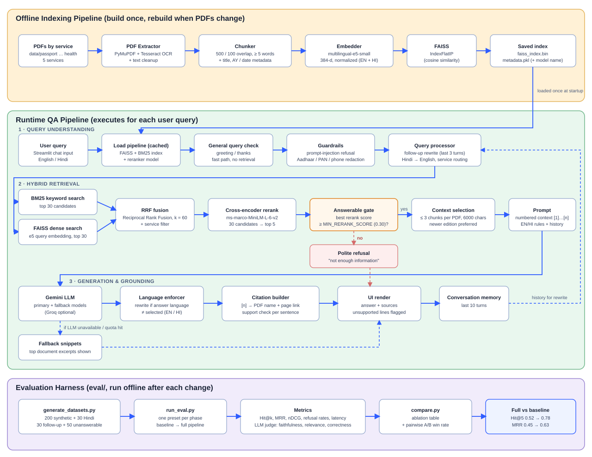

# 🏛️ InfoBridge: Smart Access to Public Services

**SMAI Assignment 3 — T10.7: Multi-Service Government RAG Chatbot**

InfoBridge is a Retrieval-Augmented Generation (RAG) chatbot for Indian government services. It retrieves information from official PDFs, formats citations, and generates grounded answers in a Streamlit interface.

## Features

- RAG pipeline over five service areas: Passport, Voter ID / EPIC, Driving Licence & RC, Income Tax, and Ayushman Bharat.
- Gemini-powered LLM responses through `src/llm/client.py` (REST API, no extra SDK), with `MODEL` and `FALLBACK_MODELS` support. Groq still works with `LLM_PROVIDER=groq`.
- Hybrid retrieval: BM25 keywords and FAISS vectors, fused with Reciprocal Rank Fusion, then reranked by a cross-encoder.
- Multilingual embeddings (`multilingual-e5-small`) for Hindi.
- Sentence-level citations `[1]` that link to the exact PDF page, plus a check that each cited sentence is supported by its source.
- Follow-up questions are rewritten into standalone questions before search, and each question is routed to the most likely service.
- Newer documents are preferred (assessment-year metadata for tax documents).
- Guardrails: Aadhaar, PAN, mobile and e-mail redaction, and prompt-injection refusal.
- An automatic evaluation harness in `eval/` that needs no hand-labelled data (see `eval/README.md`).
- Conversation memory for follow-up questions.
- English/Hindi UI support through the CSV translation layer in `frontend/translations_en_hi.csv`.
- Sidebar with a collapsible left strip, theme persistence, service filtering, and a localized service selector.
- Streamlit chat interface with reusable styling in `frontend/styles.py`.

## Architecture



Short version:

```
PDFs -> PDF extraction -> chunking -> embeddings -> FAISS index
                                         |
                                         v
User query -> guardrails -> query rewrite/translate/route
           -> BM25 + FAISS -> RRF -> cross-encoder rerank -> max 3 chunks/PDF
           -> numbered context -> Gemini LLM -> [n] citations + support check -> answer + sources
```

## How It Works

### Offline indexing (`python scripts/build_index.py`)

1. **PDF extraction** (`src/data_processing/pdf_extractor.py`): PyMuPDF reads the text of each page. Pages with no text layer (scanned PDFs) are read with Tesseract OCR when it is installed. The app still works without it, but those pages are skipped. The text is then cleaned with regex normalisation.
2. **Chunking** (`src/data_processing/chunker.py`): a recursive splitter cuts each page into 500-character chunks with 100 characters of overlap. Chunks with fewer than 5 words are dropped. This used to be 30 words, which threw away most of the short form PDFs. Each chunk keeps its service, file name, page number, a readable title, and the year or assessment year (AY) found in the file name (`src/data_processing/doc_metadata.py`).
3. **Embedding** (`src/embeddings/embedder.py`): `intfloat/multilingual-e5-small` (384-d, normalised) embeds chunks with the `passage:` prefix and queries with `query:`, as e5 expects. It runs on CUDA, Apple MPS or CPU, picked automatically.
4. **Vector store** (`src/vectorstore/store.py`): the vectors go into a FAISS `IndexFlatIP` (inner product = cosine similarity on normalised vectors). The index and metadata are saved to `vectorstore_data/`. The metadata records which embedding model built the index, and the app refuses to load an index built with a different model.
5. **Missing PDFs** (`python scripts/check_unindexed.py`): lists PDFs in `data/` that produced no chunks and gives the likely reason (scanned / image-only, password-protected, or cannot be opened).

### Runtime, per question (`src/llm/generator.py`)

1. **General query check** (`src/llm/general_responses.py`): greetings and thanks get an instant reply without retrieval.
2. **Guardrails** (`src/guardrails.py`): prompt-injection attempts ("ignore previous instructions…") are refused. Aadhaar numbers (Verhoeff-checked), PAN, mobile numbers and e-mail addresses are masked before the query reaches search or the LLM.
3. **Query understanding** (`src/retrieval/query_processor.py`):
   - Follow-ups such as "what about the fee?" are rewritten into a standalone question using the last 3 turns of history.
   - Hindi or Hinglish queries are translated to English for search, because the documents are English.
   - A keyword router picks the service (passport, tax, …) when one service clearly dominates the query.
4. **Hybrid retrieval** (`src/retrieval/retriever.py`, `bm25.py`):
   - BM25 (keywords) and FAISS (meaning) each return 30 candidates.
   - The two lists are merged with Reciprocal Rank Fusion (k = 60). This finds both exact terms like "Form 26AS" and paraphrased questions.
5. **Reranking** (`src/retrieval/reranker.py`): a cross-encoder (`ms-marco-MiniLM-L-6-v2`) reads each question–chunk pair together and re-scores the 30 candidates. The top 5 are kept.
6. **Recency**: when several yearly editions of the same document match (e.g. ITR FAQs for AY 2024-25 and AY 2025-26), the newer one gets a small bonus. If the user names a year, editions for that year get the bonus instead.
7. **Answerable gate**: if the best reranker confidence (sigmoid of the score) is below `MIN_RERANK_SCORE` (0.30), the bot says it has no information instead of guessing.
8. **Context building**: at most 3 chunks per PDF and 6000 characters in total. Each chunk is numbered `[1]…[n]` and labelled with its source.
9. **Generation** (`src/llm/client.py`, `prompts.py`):
   - Gemini is called over REST, with fallback models tried in order (Groq optional).
   - The prompt tells it to answer only from the numbered context, in the selected language, and to cite with `[n]`.
   - If the answer comes back in the wrong language, it is rewritten.
   - If the LLM is unavailable or the quota is used up, the top document snippets are shown instead.
10. **Citations** (`src/llm/citations.py`): each `[n]` marker becomes a link to the PDF and page. Each cited sentence is checked: at least half of its content words must appear in the cited chunk(s). Sentences that fail are flagged in the UI.
11. **Memory** (`src/memory/chat_memory.py`): the last 10 turns are kept for follow-up rewriting and the prompt.

## Project Structure

```
InfoBridge/
├── app.py                         # Streamlit entrypoint
├── config/
│   └── settings.py                # Central configuration (every value can be overridden in .env)
├── frontend/
│   ├── app_shell.py               # Top-level UI orchestration
│   ├── chat.py                    # Chat rendering and response flow
│   ├── pipeline.py                # Loads and caches retriever, BM25, reranker
│   ├── i18n.py                    # CSV-based UI translations
│   ├── state.py                   # Streamlit session state helpers
│   ├── styles.py                  # Theme and layout styles
│   ├── ui_components.py           # Sidebar/header/source UI
│   └── translations_en_hi.csv     # English-Hindi label mapping
├── src/
│   ├── data_processing/
│   │   ├── pdf_extractor.py       # PyMuPDF + optional Tesseract OCR
│   │   ├── chunker.py             # 500/100 recursive splitter
│   │   └── doc_metadata.py        # titles, years / AY from file names
│   ├── embeddings/
│   │   └── embedder.py            # multilingual-e5, query:/passage: prefixes
│   ├── vectorstore/
│   │   └── store.py               # FAISS index + metadata + model check
│   ├── retrieval/
│   │   ├── retriever.py           # hybrid search, RRF, rerank, gate, context
│   │   ├── bm25.py                # keyword index
│   │   ├── reranker.py            # cross-encoder
│   │   └── query_processor.py     # follow-up rewrite, translation, routing
│   ├── llm/
│   │   ├── client.py              # Gemini / Groq REST client with fallbacks
│   │   ├── prompts.py             # system + RAG prompts (EN/HI)
│   │   ├── generator.py           # orchestrates the whole runtime pipeline
│   │   ├── citations.py           # [n] markers → page citations + support check
│   │   └── general_responses.py   # greeting / thanks fast path
│   ├── memory/
│   │   └── chat_memory.py         # last 10 turns
│   └── guardrails.py              # PII redaction, prompt-injection guard
├── scripts/
│   ├── build_index.py             # build the FAISS index from data/
│   └── check_unindexed.py         # which PDFs are missing from the index, and why
├── eval/                          # evaluation harness (see eval/README.md)
│   ├── generate_datasets.py       # synthetic, Hindi, follow-up, unanswerable sets
│   ├── run_eval.py                # runs one preset, writes eval/results/<name>/
│   ├── presets.py                 # one preset per phase (baseline → full)
│   ├── metrics.py                 # Hit@k, MRR, nDCG
│   ├── judge.py                   # LLM judge: faithfulness, relevance, correctness
│   ├── compare.py                 # ablation table, pairwise A/B
│   └── tune_threshold.py          # picks MIN_RERANK_SCORE
├── utility/
│   └── language.py                # Hindi / Hinglish detection and normalisation
├── data/                          # PDFs: passport/ voter/ driving/ tax/ health/
├── vectorstore_data/              # current index (multilingual-e5)
├── vectorstore_baseline/          # old MiniLM index, kept for the baseline eval
├── implementation_pipeline_diagram.svg
├── .env.example
└── requirements.txt
```

## Quick Start

### 1. Create and activate a virtual environment

```bash
python -m venv .venv
```

macOS / Linux:

```bash
source .venv/bin/activate
```

Windows:

```bash
.venv\Scripts\activate
```

### 2. Install dependencies

```bash
pip install -r requirements.txt
```

Optional, for scanned PDFs: install Tesseract OCR (`brew install tesseract` on macOS, `sudo apt install tesseract-ocr` on Ubuntu). Without it, scanned pages are skipped.

The first run downloads the embedding model and the reranker from Hugging Face (about 0.6 GB in total).

### 3. Set your API key

Copy `.env.example` to `.env` and paste your Gemini key (from https://aistudio.google.com/apikey):

```bash
LLM_PROVIDER=gemini
GEMINI_API_KEY=your_gemini_api_key_here
MODEL=gemini-3.6-flash
FALLBACK_MODELS=gemini-3.8-flash,gemini-3.5-flash-lite
```

`.env` is git-ignored. Never commit real keys.

### 4. Add PDFs

Place government PDFs in the appropriate service folders:

```
data/
├── passport/    # Passport instruction booklets, FAQs
├── voter/       # Voter registration forms, guides
├── driving/     # DL application guides, Parivahan docs
├── tax/         # ITR form instructions, tax guides
└── health/      # Ayushman Bharat guidelines, PM-JAY docs
```

### 5. Build the FAISS index

```bash
python scripts/build_index.py
python scripts/check_unindexed.py   # optional: lists PDFs that produced no chunks
```

Rebuild the index whenever you add PDFs or change `EMBEDDING_MODEL`, `CHUNK_SIZE` or `CHUNK_OVERLAP`.

### 6. Run the app

```bash
streamlit run app.py
```

## Technology Stack

| Component       | Technology                           |
|-----------------|---------------------------------------|
| Frontend        | Streamlit                             |
| Backend         | Python                                |
| Embeddings      | intfloat/multilingual-e5-small        |
| Keyword search  | BM25 (scikit-learn + scipy)           |
| Reranker        | cross-encoder/ms-marco-MiniLM-L-6-v2  |
| Vector Store    | FAISS (faiss-cpu)                     |
| LLM             | Google Gemini (REST)                  |
| PDF Parsing     | PyMuPDF (+ optional Tesseract OCR)    |
| Text Splitting  | LangChain Text Splitters              |

## Configuration

All settings live in `config/settings.py`, and any of them can be overridden in `.env`. These are the main ones:

| Setting | Default | What it does |
|---|---|---|
| `LLM_PROVIDER` | `gemini` | `gemini` or `groq` |
| `MODEL` / `FALLBACK_MODELS` | `gemini-3.6-flash` / `gemini-3.8-flash,gemini-3.5-flash-lite` | Primary model, then fallbacks tried in order |
| `EMBEDDING_MODEL` | `intfloat/multilingual-e5-small` | Changing it requires an index rebuild |
| `EMBEDDING_DEVICE` | `auto` | `auto` (CUDA → MPS → CPU), or force one |
| `CHUNK_SIZE` / `CHUNK_OVERLAP` / `MIN_CHUNK_WORDS` | `500` / `100` / `5` | Chunking (rebuild after changing) |
| `RETRIEVAL_MODE` | `hybrid` | `dense` (FAISS), `bm25`, or `hybrid` (both + RRF) |
| `CANDIDATE_POOL` / `RRF_K` | `30` / `60` | Candidates per retriever, RRF constant |
| `USE_RERANKER` / `RERANKER_MODEL` | `true` / `cross-encoder/ms-marco-MiniLM-L-6-v2` | Cross-encoder reranking |
| `TOP_K` | `5` | Chunks kept after reranking |
| `MAX_CHUNKS_PER_SOURCE` / `MAX_CONTEXT_CHARS` | `3` / `6000` | Context limits for the LLM |
| `MIN_RERANK_SCORE` | `0.30` | Answerable gate when the reranker is on (tune with `eval/tune_threshold.py`) |
| `MIN_ANSWER_SCORE` | `0.80` (e5) / `0.45` (MiniLM) | Gate when the reranker is off (cosine similarity) |
| `EXPAND_NEIGHBORS` | `false` | Also send the chunk before/after each hit |
| `ENABLE_QUERY_REWRITE` / `QUERY_REWRITE_HISTORY_TURNS` | `true` / `3` | Follow-up rewriting |
| `ENABLE_SERVICE_ROUTING` | `true` | Keyword-based service routing |
| `ENABLE_INLINE_CITATIONS` / `CITATION_SUPPORT_THRESHOLD` | `true` / `0.5` | `[n]` citations and the per-sentence support check |
| `PREFER_RECENT_DOCS` / `RECENCY_WEIGHT` | `true` / `0.05` | Newer-edition bonus |
| `ENABLE_PII_REDACTION` / `ENABLE_INJECTION_GUARD` | `true` / `true` | Guardrails |

## UI Notes

- The sidebar is collapsible and leaves a narrow left strip when closed.
- Dark mode and light mode are persisted in session state.
- The language selector is English/Hindi only, and the labels are translated from the CSV file.
- The service filter is localized to the selected UI language.


## Evaluation

The `eval/` folder generates its own test data from the PDFs and measures retrieval (Hit@k, MRR, nDCG), answer faithfulness, relevance and correctness (LLM judge), refusal of out-of-scope questions, Hindi and follow-up retrieval, and latency. Each phase has a preset, so the results form an ablation table. See [eval/README.md](eval/README.md).

### Running it

```bash
python eval/generate_datasets.py                        # once: builds the test sets in eval/data/
python eval/run_eval.py --preset baseline --skip e2e    # retrieval only: fast, no LLM calls
python eval/run_eval.py --preset full                   # full run, including LLM-judged answers
python eval/compare.py --out eval/results/ablation.md   # table across all runs
python eval/compare.py --pairwise baseline full         # LLM judge picks the better answer
python eval/tune_threshold.py full                      # suggests MIN_RERANK_SCORE
```

Presets: `baseline`, `p2_context`, `p3_hybrid`, `p3_rerank`, `p4_query`, `full`. Use `--set KEY=VALUE` to override any setting for one run.

### Results

Retrieval results on 200 auto-generated questions (40 per service), page-level match. Each row adds one change on top of the row above it.

| Run | Change | Hit@1 | Hit@5 | MRR | nDCG@10 | Unanswerable refused | Latency p50 |
|---|---|---|---|---|---|---|---|
| Baseline | MiniLM + FAISS only, 1 chunk per PDF, 2000-char context | 0.41 | 0.52 | 0.455 | 0.471 | 20% | 11 ms |
| Phase 2 | up to 3 chunks per PDF, 6000-char context | 0.41 | 0.68 | 0.524 | 0.575 | 20% | 13 ms |
| Phase 3a | hybrid BM25 + FAISS (RRF) | 0.46 | 0.74 | 0.577 | 0.624 | 20% | 13 ms |
| Phase 3b | + cross-encoder reranker | 0.53 | 0.78 | 0.631 | 0.672 | 56% | 203 ms |
| Phase 4 | + query rewrite, service routing, multilingual-e5 | 0.52 | 0.775 | 0.625 | 0.666 | 56% | 195 ms |
| **Full** | + tuned gate (`MIN_RERANK_SCORE=0.30`), recency only within a document family | **0.52** | **0.775** | **0.625** | **0.666** | **74%** | 201 ms |

Full pipeline compared with the baseline:

- Top-5 retrieval accuracy (Hit@5): 0.52 → 0.775 (+49%). MRR: 0.455 → 0.625 (+37%).
- Hit@5 by service: tax 0.40 → 0.85, voter 0.45 → 0.725, passport 0.55 → 0.80, health 0.40 → 0.625, driving 0.80 → 0.875.
- Hindi questions (30): Hit@5 0.83. Top-5 overlap with the English version of the same question: 0.69.
- Follow-up questions (30): Hit@5 0.43 as typed → 0.77 after rewrite (upper bound with the full question: 0.83).
- Unanswerable questions (50): 74% refused by the confidence gate, while 1% of answerable questions were wrongly refused.

The test questions are generated automatically from the indexed chunks, so absolute scores are optimistic. The comparison between runs is what matters. The end-to-end answer evaluation (LLM-judge faithfulness and correctness) is implemented but has not been run yet.

## Troubleshooting

- If the UI text looks stale, restart Streamlit and hard refresh the browser.
- If the app cannot answer, rebuild the index and confirm `GEMINI_API_KEY` is set in `.env`.
- "The index was built with ... but EMBEDDING_MODEL is ...": rebuild with `python scripts/build_index.py`, or set `EMBEDDING_MODEL` back to the model that built the index.
- 429 errors: the Gemini free tier limits requests per minute. Wait a minute, or add another model to `FALLBACK_MODELS`.
